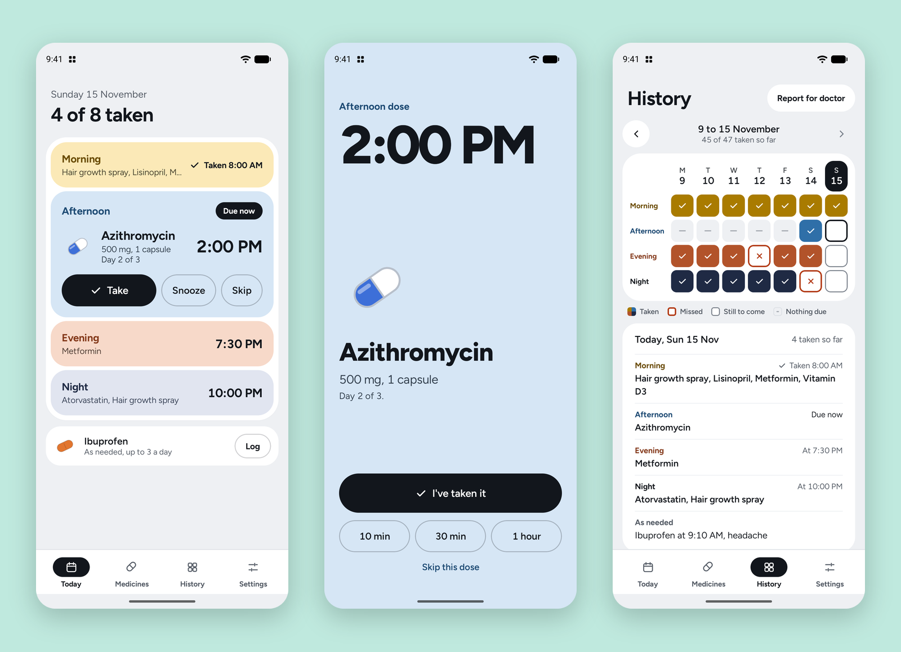
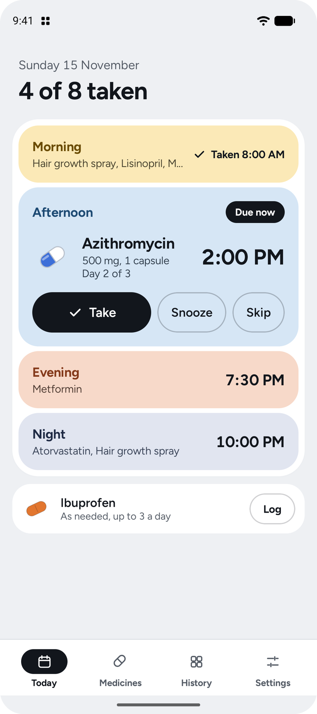
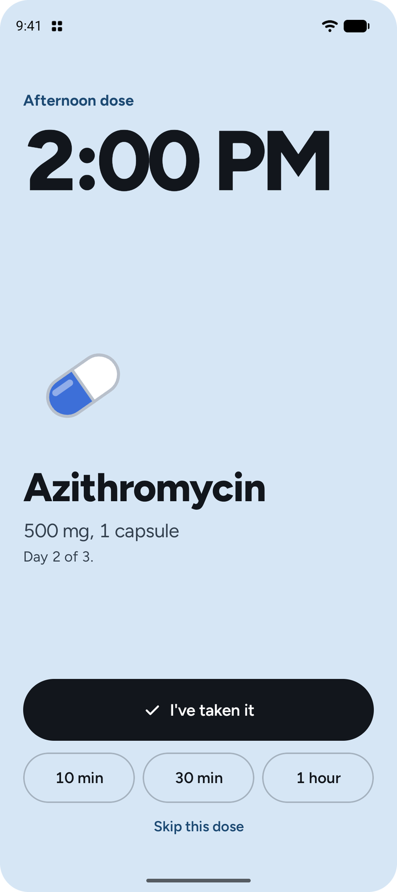
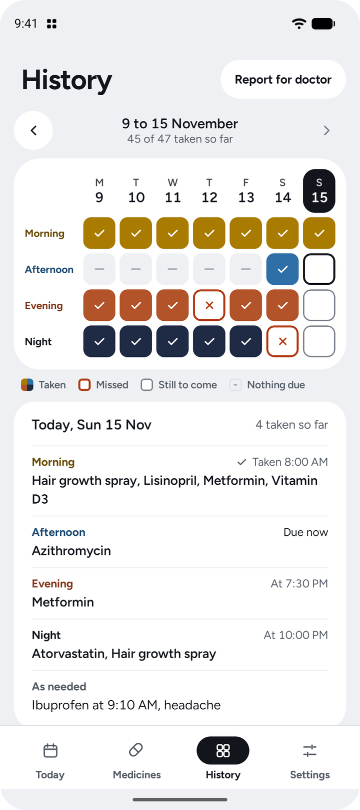
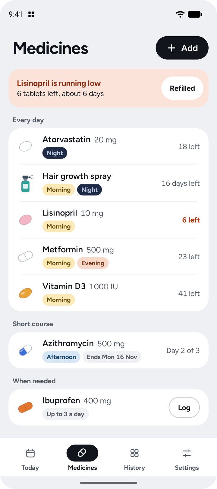
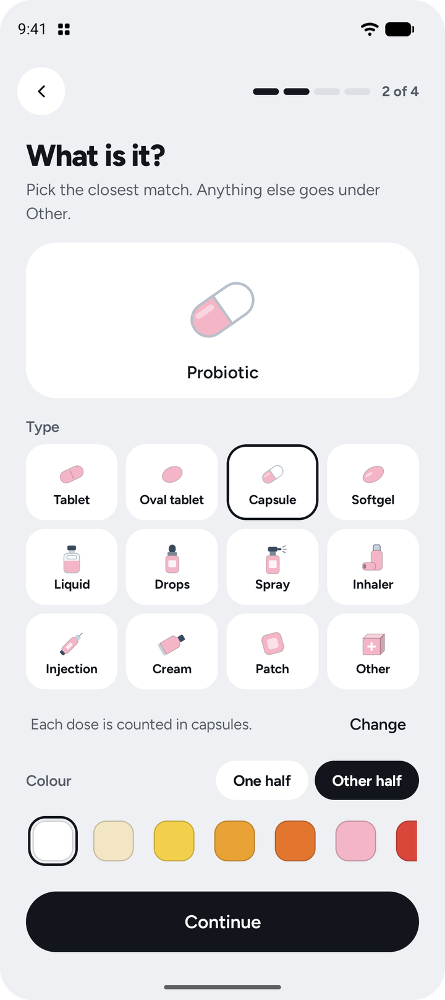
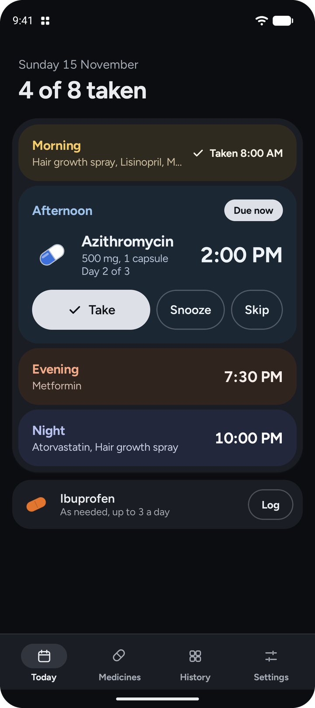

# Rexi

A calm medication tracker for Android. Your day is a pillbox with four compartments, Morning, Afternoon, Evening and Night, and Rexi makes sure each one gets answered.

Everything stays on your phone. There's no account, and the app can't reach the internet.



## What it does

- **Any kind of medicine.** Tablets, capsules, liquids, drops, sprays, inhalers, injections, creams and patches, each with its own drawing and colour so you can tell them apart. Anything else goes under Other, and you can count doses in a word of your own.
- **Reminders that don't give up.** A reminder rings at the time you set for each part of the day, and again every 10 minutes until you answer. It can show over the lock screen like an alarm, and quiet hours keep the night silent.
- **Answer from anywhere.** Take, snooze or skip from Today, from the notification, from the full screen reminder, or from the home screen widget.
- **Missed doses, and late ones.** A dose nobody answered is marked as missed after a few hours. If you took it after all, say when.
- **Never run out.** Count what's left, or just say how long a bottle lasts. Rexi warns you a few days or a week ahead.
- **When needed.** For medicines like ibuprofen, set a gap between doses and a daily limit. Rexi warns you if it's too soon and offers to remind you when it's fine.
- **Short courses.** Antibiotics and other courses show which day you're on and stop by themselves.
- **History and a report.** A week at a glance as a pillbox grid, and a PDF of the last 30 days to show your doctor.
- **Private.** An app lock with your fingerprint or PIN, and an option to hide medicine names in notifications.
- **Yours.** Back up to a file and restore it on a new phone. Light, dark, or follow the system, and the clock follows your phone's 12 or 24 hour setting.

## Screenshots

<table>
  <tr>
    <td width="33%"></td>
    <td width="33%"></td>
    <td width="33%"></td>
  </tr>
  <tr>
    <td align="center">Today</td>
    <td align="center">Reminder</td>
    <td align="center">History</td>
  </tr>
  <tr>
    <td width="33%"></td>
    <td width="33%"></td>
    <td width="33%"></td>
  </tr>
  <tr>
    <td align="center">Medicines</td>
    <td align="center">Adding a medicine</td>
    <td align="center">Dark mode</td>
  </tr>
</table>

## Privacy

Everything stays on your phone. Rexi doesn't have the Android internet permission, so it can't send anything anywhere. There are no accounts, analytics or ads.

Android's own backup and device transfer are turned off for its data. Your backup is a file you save where you choose. On a shared phone, the app lock and hidden names in notifications keep your medicines to yourself.

## Install

Rexi isn't available to install yet. It's coming to Google Play, for Android 15 or newer.

When you first open it, set the times for your day, and allow the permissions below.

| Permission | Why |
| --- | --- |
| Notifications | To remind you when a dose is due. Without it, reminders can't reach you |
| Alarms and reminders | To ring at the exact minute, not several minutes late |
| Full screen notifications | Optional. Shows a reminder over the lock screen, like an alarm |

## Limits

- It records what you log. It can't know whether you took a dose.
- Reminders follow your phone's clock and time zone, so they move with you when you travel.
- Some phones add battery savers that can delay or stop reminders. If they come late, allow Rexi to run in the background in Android's battery settings.
- Nothing syncs between phones. To move to a new one, back up to a file and restore it there.
- It doesn't check doses, or how medicines interact.

## Disclaimer

Rexi is a personal project, provided as is, with no warranty, and you use it at your own risk. It isn't a medical device and it doesn't give medical advice. It can fail to remind you, for example when the phone is off or Android stops the app, so don't rely on it alone for a medicine where a missed dose is dangerous. Follow what your doctor or pharmacist tells you. The people involved in this project aren't responsible for any harm or loss.

## Build from source

You need JDK 21 and the Android SDK with API level 37.

```sh
./gradlew check                    # formatting, lint and tests
./gradlew spotlessApply            # fix formatting
./gradlew :app:testDebugUnitTest   # run the tests
./gradlew :app:assembleDebug       # build a debug APK
```

Git hooks check formatting, commit messages and the build before code leaves your machine. Set them up once per clone with `brew install lefthook && lefthook install`.

A release build needs your own signing key. Without one, it builds unsigned. Add a `keystore.properties` file to the project root, and never commit it:

```properties
storeFile=/path/to/your-release.jks
storePassword=...
keyAlias=...
keyPassword=...
```

Then run `./gradlew :app:assembleRelease`.

Before changing the code, read [AGENTS.md](AGENTS.md). It explains how the code is laid out, and the rules it must keep, such as never gaining the internet permission. It's written for AI coding agents, but it works for people too.

## Credits

The [Figtree](https://github.com/erikdkennedy/figtree) typeface is used under the SIL Open Font License, included in `third_party/`.

## Licence

Rexi's code is public, but it isn't open source. You can read it, change it and build it for yourself. You can't use it to make or share an app that competes with Rexi, whether it's free or paid. The full terms are in the [PolyForm Shield License 1.0.0](LICENSE).

The licence doesn't cover the Rexi name or logo.
